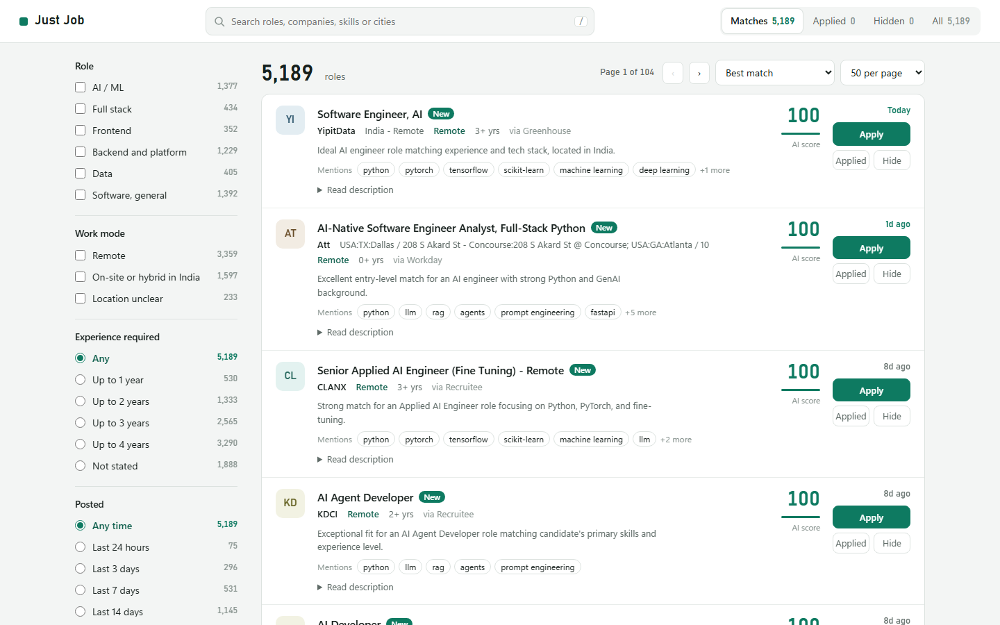
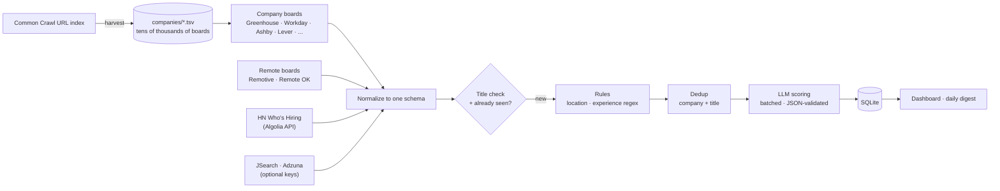

# Just Job

A job search pipeline for AI, ML and full-stack engineering roles. Several times a day it pulls
postings straight from the career boards of tens of thousands of companies (the way Remote
Rocketship does), plus remote job boards and job APIs. Rules filter them, an LLM scores what's left,
and a local dashboard shows the ranked list. For Greenhouse and Ashby jobs, an apply agent drafts
the answers, fills in the form in my browser and waits for me to press Submit.



From a recent full run: about 804,000 listings from 31,700 company boards and feeds, of which about
7,300 matches survive the title, location, experience and dedup steps (4,400 duplicate postings
hidden). A full run takes about an hour; the hourly refresh, about 10 minutes. The AI step scores up
to 1,000 new jobs per run on Gemini's free tier.

## Why

Job boards are noisy. Most "AI Engineer" results want 5-10 years, are in the wrong country, or are
the same posting copied across five sites. Finding the 2% worth applying to took me hours, so this
reads the postings for me and only asks an LLM about the ones a cheap rule can't decide.

## How it works



**Finding companies.** ATS vendors don't publish their customer lists, so `harvest` reads Common
Crawl's public URL index, takes every company slug seen under each ATS domain
(`boards.greenhouse.io/<slug>`, `<tenant>.wd5.myworkdayjobs.com/<site>`, ...), checks each one
against the ATS's API and saves the live ones to `companies/<ats>.tsv`. I re-run it monthly.

**Fetching.** Each source is a module that returns jobs in one schema, with its own thread pool, so
a rate-limited site doesn't hold up the others. Boards that keep failing are retried after 1, 2, 4,
... days instead of every run. Workday boards are searched for my title words, which skips most of a
bank's or retailer's postings. Everything uses public endpoints without logging in; nothing scrapes
LinkedIn, Indeed or Glassdoor.

**Title check.** A title needs a role word and a domain word (`Backend` + `Engineer`) and none of the
excluded words (`staff`, `principal`, `intern`, ...). Jobs already in the database are skipped, and
sources that need an extra request per description (Greenhouse, SmartRecruiters) only fetch it for
new jobs whose titles pass.

**Rules.** A location check (on-site cities, or remote with detection of "Remote - US" style
restrictions) and an experience regex that reads `3+ years`, `1–2 years`, `at least three years`,
`between 2 and 4 years`, `new grad`, ... and ignores `founded 10 years ago` and `4-year degree`. A job
that clearly needs too much experience is dropped; when it's unclear, the LLM decides. "Senior"
titles survive only if the posting asks for few enough years.

**Dedup.** The same role on several sites shows once, preferring the company's own board. Dedup runs
after filtering, so a copy in a city I can't work in never hides the copy I can apply to.

**LLM scoring.** Ten trimmed postings per call (benefits and EEO boilerplate removed, requirement
lines kept first) return `min_years_required`, `is_within_limit`, `match_score`, a one-line reason
and flags such as `frontend-only` or `requires-phd`. The output is validated and retried once if it
isn't usable JSON. Each job is analyzed once.

**Ranking.** The score is the LLM's, or a rule score without a key, plus a remote bonus and minus a
stale-posting penalty. On the dashboard, Applied and Hide take a job off the list. Postings that
disappear from their board are marked closed; jobs I applied to stay on the Applied tab with the date.

**Profile.** The Profile page holds what the filters, the AI and the apply agent know about me. An
uploaded resume (PDF, DOCX or TXT) is parsed by the LLM into jobs with dates and bullet points,
schooling, projects and skills, which fill in empty fields but never overwrite mine. Years of
experience come from the job dates (internships left out, overlapping jobs counted once) rather than
from the model's arithmetic. Changing skills or the experience limit re-filters stored jobs in the
background.

**Apply agent.** On a Greenhouse or Ashby job, Auto-fill reads the form's questions from the ATS's
public endpoints and drafts each answer from the first source that has it:

- my profile, plus fixed rules for the questions every form asks. Work authorization and sponsorship
  depend on the job's country and the countries I can work in, pay on the job's currency;
- my own answers from earlier forms, for the same question or one worded almost the same;
- the LLM, which may only use my profile and resume and has to quote the fact it used. If the quote
  isn't actually in my profile, or the choice isn't one of the form's options, the answer comes back
  to me. It can also reuse one of my earlier answers for a question that means the same in other
  words, but it has to name which one, and that answer's value is what goes in.

The review page shows each answer and where it came from, and flags what needs me: drafts of open
questions, statements I'd be signing (arbitration, certifications) and anything nobody could answer.
Fill in browser opens the form in Edge or Chrome through Playwright (with its own profile in
`data/browser`), fills it, outlines what's left and stops. I press Submit; the agent sees the
confirmation page, saves a screenshot and marks the job applied. It never submits on its own, stops
at a daily cap and warns about duplicate applications. Workday and other sites that need an account
stay manual.

**The agent learns from me.** While the form is open, the agent keeps reading what each field holds,
and reads it once more the moment I press Submit (pressed Yes/No buttons, the chosen value of a
searchable dropdown, ticked boxes, typed text). After a confirmed submission it compares that with
its own draft:

- Anything I typed, picked or changed is saved. The next form that asks gets it filled in, outlined
  for me to check until I've kept it on two forms; after that it fills without asking. Changing an
  answer resets that count.
- Correcting an answer that came from my profile or a rule makes mine win for that question.
- Written answers stay drafts, and are flagged when they name the company they were written for.
- Work authorization and visa answers depend on the job's country, so they aren't saved as answers:
  "Yes" to "Are you authorized to work in the country where this job is located?" for a job in India
  adds India to my profile instead. Statements I sign and voluntary disclosures are never saved.

Each application records how many answers went in without an edit from me. The Answers page shows
that per application, so I can see the agent getting better, and lists every saved answer to edit or
delete.

## Design decisions

- Rules first, AI only where it's needed. Regexes and keyword checks are free and deterministic, and
  the LLM only sees jobs they couldn't settle, so daily usage fits in free tiers.
- Any OpenAI-compatible API works (Gemini, Groq, OpenRouter, ...). Providers are picked by name in
  the config, with a fallback when the main one fails or rate-limits.
- No required dependencies. The pipeline and dashboard use only the standard library (`urllib`,
  `sqlite3`, `tomllib`, `http.server`), so they run anywhere Python 3.11+ is installed, including a
  scheduled task. PDF resumes (`pypdf`) and the apply agent (`playwright`) are optional extras in
  `requirements-extras.txt`.
- Title words, locations, ranking weights and company boards live in `config.toml`. The profile lives
  on the Profile page and is seeded from `config.toml` the first time. `refilter` re-applies changed
  rules to stored jobs without refetching.

## Quick start

```bash
git clone https://github.com/ankit67776/JustJob && cd JustJob
cp .env.example .env                     # optional: a free Gemini key for AI scoring
pip install -r requirements-extras.txt   # optional: PDF resumes and the apply agent
# edit [filters.location] in config.toml; fill in the Profile page once the dashboard is up
python -m justjob harvest       # once, then monthly: find company boards (~1 hour)
python -m justjob run           # fetch, filter, rank, write the digest
python -m justjob serve         # dashboard at http://127.0.0.1:8765
```

Without any keys it runs on the free sources with rule-based ranking.

| Command | What it does |
|---|---|
| `run` | Full pipeline (`--only greenhouse,ashby`, `--no-ai`, `--no-notify`) |
| `run --hot` | Quick refresh: companies with a match in the last 60 days, plus the remote boards |
| `serve` | Dashboard with the Jobs, Profile and Answers pages. `--host 0.0.0.0` needs `DASHBOARD_PASSWORD` in `.env` |
| `list`, `mark <id> applied` | The same from the terminal |
| `apply <id> [--fill]` | Draft answers for a job's form and print them; `--fill` opens it in the browser |
| `refilter` | Re-apply edited filters to stored jobs |
| `analyze [--redo]` | AI step only; `--redo` re-scores after a profile change |
| `stats` | Companies tracked, board health, per-source counts and top rejection reasons |
| `harvest [--crawls 3]` | Find company boards in Common Crawl, check them, add the live ones to `companies/` |
| `discover [--add]` | Find company boards linked from fetched jobs (and add them to `companies/`) |
| `models` | List the models your AI key can use |

To schedule it on Windows (full run every 4 hours, quick refresh every hour):
`powershell -ExecutionPolicy Bypass -File scripts\schedule_windows.ps1 -At 9am -EveryHours 4`.
For running it on a server with the dashboard behind a password and HTTPS, see
[docs/DEPLOY.md](docs/DEPLOY.md). Telegram and email digests are set up in `.env.example`.

## Sources

| Source | Key | Notes |
|---|---|---|
| Company boards: Greenhouse, Workday, Ashby, Lever, SmartRecruiters, Workable, BambooHR, Breezy HR, Recruitee, Personio, Teamtailor, Rippling, Gem | none | Per company, in `companies/<ats>.tsv` (from `harvest`) and `config.toml`. `discover --add` finds more from links in fetched jobs |
| Remote boards: Remotive, Remote OK, We Work Remotely, Himalayas, Jobicy, Working Nomads | none | Links point back to the original postings, as their terms require |
| HN "Who is hiring?" | none | Latest monthly thread, via the Algolia HN API |
| JSearch (RapidAPI) | `JSEARCH_API_KEY` | Google for Jobs: LinkedIn, Indeed, Glassdoor, Naukri, and company sites on Workday, iCIMS, JazzHR, ... |
| Adzuna | `ADZUNA_APP_ID`, `ADZUNA_APP_KEY` | Large aggregator, per country |

Workday has no official API, so this reads the same public JSON its career sites load in the
browser. Not included: LinkedIn, Glassdoor and Wellfound (no public endpoints, scraping breaks their
terms, and their listings mostly reach Google for Jobs, which JSearch covers), and iCIMS and Jobvite
(HTML-only career sites). Common Crawl doesn't crawl `jobs.lever.co`, so Lever companies come from
`config.toml` and `discover`. Workable blocks an IP for about a day after a few thousand requests, so
each run fetches 300 of its boards, oldest-checked first. A source that answers HTTP 429 is left
alone for the rest of the run.

## Project layout

```
companies/         company boards per ATS, written by `harvest` and `discover --add`
justjob/
  sources/         one module per source, each returning the common Job schema
  harvest.py       company discovery from the Common Crawl index
  registry.py      reads and writes companies/<ats>.tsv
  filters.py       title, location and experience rules, and the rule score
  pipeline.py      fetch -> rules -> dedup -> AI -> digest
  ai.py            batching, prompt, JSON validation, provider fallback
  db.py            SQLite schema and queries
  profile.py       profile fields, resume text extraction, LLM resume parsing
  apply/           the apply agent: forms.py (form schemas), answers.py (drafting), browser.py (filling),
                   memory.py (learning from submitted forms)
  web.py           dashboard server (stdlib http.server) and the Jobs page
  profile_page.py  Profile page
  apply_page.py    apply review page
  answers_page.py  Answers page: what the agent learned, and how often it needed no edit
  ui.py            shared styles and top bar
  digest.py        Markdown and HTML daily digest
tests/             unit and end-to-end tests (fake sources, fake LLM server, in-memory DB)
```

## Tests

```bash
python -m unittest discover -s tests -t .
ruff check .
```

The browser tests need Playwright and Edge, and are skipped without them.

## Roadmap

- Application tracker with stages (assessment, interview, offer) and a funnel by source and score.
- Evals: a labeled set from my Applied and Hidden decisions for the scoring, and question/answer pairs
  for the apply agent, run in CI.
- More forms for the agent: Workable, BambooHR, Breezy, Lever.

## License

MIT
