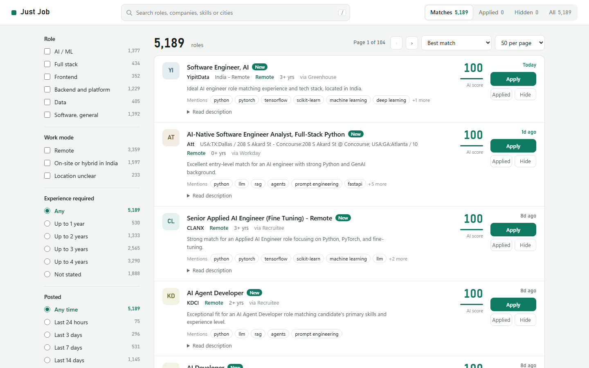
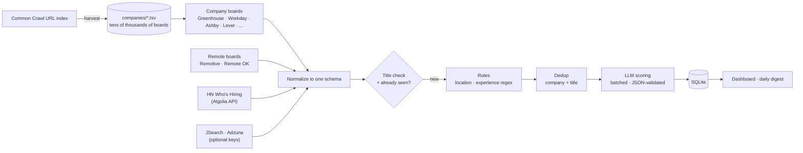

# Just Job

An AI-assisted job search pipeline. Several times a day it collects AI / ML / full-stack
engineering postings straight from the career boards of tens of thousands of companies (the way
Remote Rocketship does), plus remote job boards and job APIs, filters them with rules, scores the
survivors with an LLM, and shows a ranked list with apply links. Applying stays manual.



**Numbers from a real run:** 33,755 company boards found by `harvest`; one run checks about 811,000
listings from 31,846 boards and feeds and keeps about 5,200 matches after the title, location,
experience and dedup steps (2,000 duplicate postings hidden). A full run takes about 40 minutes.
The AI step scores 300 jobs per run in about 6 minutes on Gemini's free tier.

## Why

Job boards are noisy: most "AI Engineer" results want 5-10 years, are in the wrong country, or
are the same posting copied across five sites. Reading postings to find the 2% worth applying
to takes hours. This tool reads them for me and only asks an LLM about the ones a cheap rule
couldn't decide.

## How it works



0. **Harvest companies.** Applicant tracking systems don't publish their customer lists, so
   `harvest` reads Common Crawl's public index of crawled URLs, takes every company slug seen
   under each ATS domain (`boards.greenhouse.io/<slug>`, `<tenant>.wd5.myworkdayjobs.com/<site>`,
   ...), checks each against the ATS's API and saves the live ones to `companies/<ats>.tsv`.
   Re-run it monthly to pick up new companies.
1. **Fetch.** Each source is its own module that returns jobs in a common schema. Each source has
   its own thread pool, so a rate-limited site never holds up the others; boards that keep failing
   are retried after 1, 2, 4, ... days instead of every run. Workday boards are searched for your
   title words, which skips most of a bank's or retailer's postings. Only public endpoints are
   used (no logins), with no scraping of LinkedIn, Indeed or Glassdoor.
2. **Title check + seen tracking.** A title needs a role word and a domain word
   (`Backend` + `Engineer`) and no excluded word (`staff`, `principal`, `intern`, ...). Jobs already
   in the database are skipped. Descriptions that need an extra request per job (Greenhouse,
   SmartRecruiters) are only downloaded for new jobs whose titles pass.
3. **Rules.** A location check (on-site cities or remote, with region detection for
   "Remote - US"-style restrictions) and an experience regex that reads `3+ years`, `1–2 years`,
   `at least three years`, `between 2 and 4 years`, `new grad`, ... while ignoring
   `founded 10 years ago` and `4-year degree`. A job that clearly needs too much experience is dropped. If it's unclear,
   the LLM decides. "Senior" titles survive only when the posting asks for few enough years.
4. **Dedup.** The same role on several sites is shown once, preferring the direct company board.
   Dedup runs *after* filtering, so a copy in a city you can't work in never hides the copy you
   can apply to.
5. **LLM scoring.** Ten trimmed postings per call (boilerplate such as benefits and EEO text is removed;
   requirement lines are kept first) → `min_years_required`, `is_within_limit`, `match_score`,
   a one-line reason, and flags (`frontend-only`, `requires-phd`, ...). Output is JSON-validated
   and retried once on failure. Each job is analyzed exactly once.
6. **Rank and review.** The score is the LLM's score, or a rule score when there's no key, plus a
   remote bonus and minus a stale-posting penalty. In the dashboard, **Applied** and **Hide** take a job off the
   list. Postings that disappear from their company board are marked closed automatically.

## Design decisions

- **Rules first, AI only where needed.** Regex and keyword checks are free and deterministic.
  The LLM sees only jobs the rules couldn't settle, so daily usage stays within free tiers.
- **Provider-agnostic LLM layer.** Any OpenAI-compatible API works (Gemini, Groq, OpenRouter,
  ...). You switch providers by name in config, and a fallback provider is used if the main one fails or
  is rate-limited.
- **No dependencies.** It uses only the standard library (`urllib`, `sqlite3`, `tomllib`, `http.server`), so it
  runs anywhere Python 3.11+ is installed, including a scheduled task.
- **Everything is config.** Profile, skills, title words, locations, ranking weights and company
  boards live in `config.toml`. `refilter` re-applies changed rules to stored jobs without
  refetching.

## Quick start

```bash
git clone https://github.com/ankit67776/JustJob && cd JustJob
cp .env.example .env              # optional: add a free Gemini key for AI scoring
# edit config.toml: [profile] and [filters.location]
python -m justjob harvest       # once (and then monthly): find company boards, ~1 hour
python -m justjob run           # fetch, filter, rank, write the digest
python -m justjob serve         # dashboard at http://127.0.0.1:8765
```

Without any keys it runs on the free sources with rule-based ranking.

| Command | What it does |
|---|---|
| `run` | Full pipeline (`--only greenhouse,ashby`, `--no-ai`, `--no-notify`) |
| `run --hot` | Quick refresh (~5 min): companies with a match in the last 60 days plus the remote boards |
| `serve` | Dashboard: Matches / Applied / Hidden. `--host 0.0.0.0` needs `DASHBOARD_PASSWORD` in `.env` |
| `list`, `mark <id> applied` | The same from the terminal |
| `refilter` | Re-apply edited filters to stored jobs |
| `analyze [--redo]` | AI step only; `--redo` re-scores after a profile change |
| `stats` | Companies tracked, board health, per-source counts and top rejection reasons |
| `harvest [--crawls 3]` | Find company boards in Common Crawl, check them, add live ones to `companies/` |
| `discover [--add]` | Find company boards linked from fetched jobs (and add them to `companies/`) |
| `models` | List models your AI key can use |

Schedule on Windows (full run every 4 hours, quick refresh every hour):
`powershell -ExecutionPolicy Bypass -File scripts\schedule_windows.ps1 -At 9am -EveryHours 4`.
To run it on a server around the clock, with the dashboard behind a password and optional HTTPS,
see [docs/DEPLOY.md](docs/DEPLOY.md). Optional Telegram / email digests: see `.env.example`.

## Sources

| Source | Key | Notes |
|---|---|---|
| **Company boards:** Greenhouse, Workday, Ashby, Lever, SmartRecruiters, Workable, BambooHR, Breezy HR, Recruitee, Personio, Teamtailor, Rippling, Gem | – | Per company, in `companies/<ats>.tsv` (from `harvest`) and `config.toml`. `discover --add` finds more from links in fetched jobs |
| **Remote boards:** Remotive, Remote OK, We Work Remotely, Himalayas, Jobicy, Working Nomads | – | Links point back to the original postings, as their terms require |
| HN "Who is hiring?" | – | Latest monthly thread via the Algolia HN API |
| JSearch (RapidAPI) | `JSEARCH_API_KEY` | Google for Jobs: LinkedIn, Indeed, Glassdoor, Naukri, and company sites on Workday, iCIMS, JazzHR, ... |
| Adzuna | `ADZUNA_APP_ID`, `ADZUNA_APP_KEY` | Large aggregator, per-country |

Workday has no official API; the tool reads the same public JSON its career sites load in the
browser, without logging in. Not included: LinkedIn, Glassdoor, Wellfound (no public endpoints;
scraping breaks their terms, and their listings mostly reach Google for Jobs, which JSearch
covers) and iCIMS / Jobvite (HTML-only career sites). Common Crawl doesn't crawl `jobs.lever.co`,
so Lever companies come from `config.toml` and `discover`. Workable blocks an IP for about a day
after a few thousand requests, so each run fetches 300 of its boards (oldest-checked first), and a
source that answers HTTP 429 is left alone for the rest of that run.

## Project layout

```
companies/      company boards per ATS, written by `harvest` and `discover --add`
justjob/
  sources/      one module per source -> common Job schema
  harvest.py    company discovery from the Common Crawl index
  registry.py   reads / writes companies/<ats>.tsv
  filters.py    title / location / experience rules + rule score
  pipeline.py   fetch -> rules -> dedup -> AI -> digest
  ai.py         batching, prompt, JSON validation, provider fallback
  db.py         SQLite schema and queries
  web.py        dashboard (stdlib http.server) and HTML rendering
  digest.py     Markdown / HTML daily digest
tests/          unit + end-to-end tests (fake sources, fake LLM server, in-memory DB)
```

## Tests

```bash
python -m unittest discover -s tests -t .
```

## Roadmap

- Draft tailored resume bullets and a cover letter for top matches (for manual review).
- Track application outcomes to learn which kinds of jobs respond.

## License

MIT
